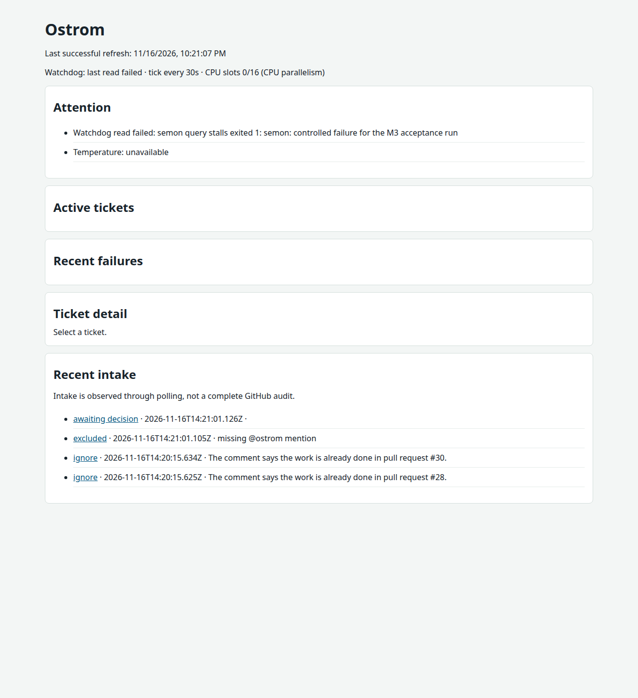
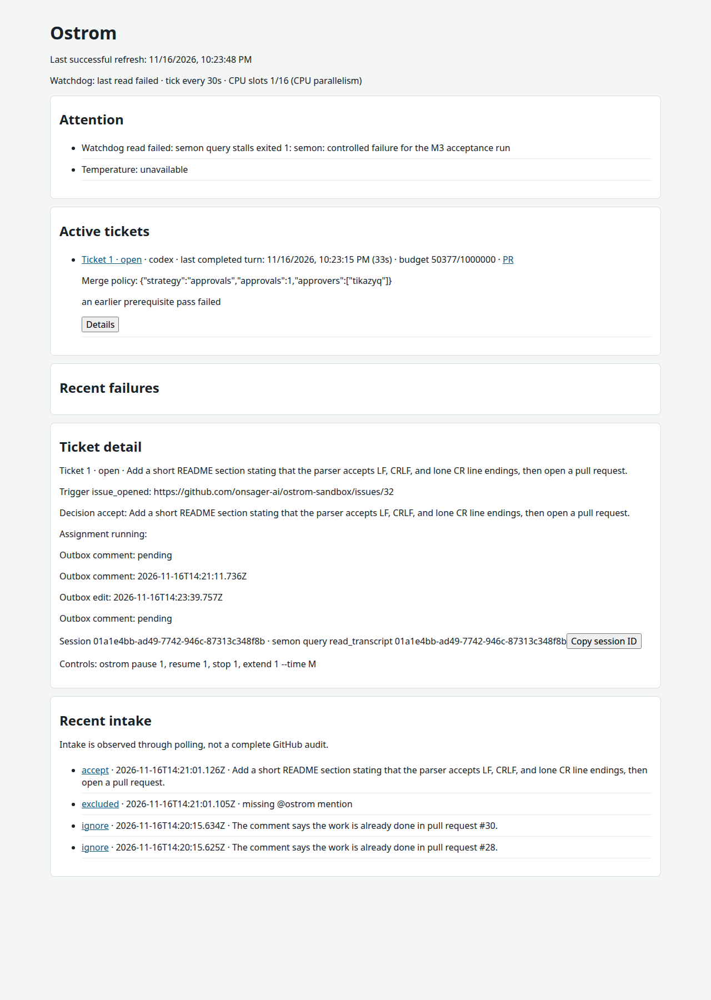
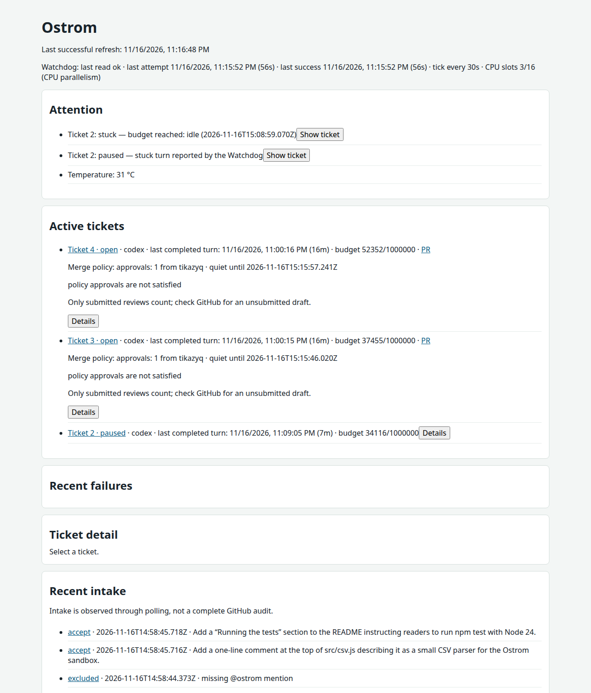
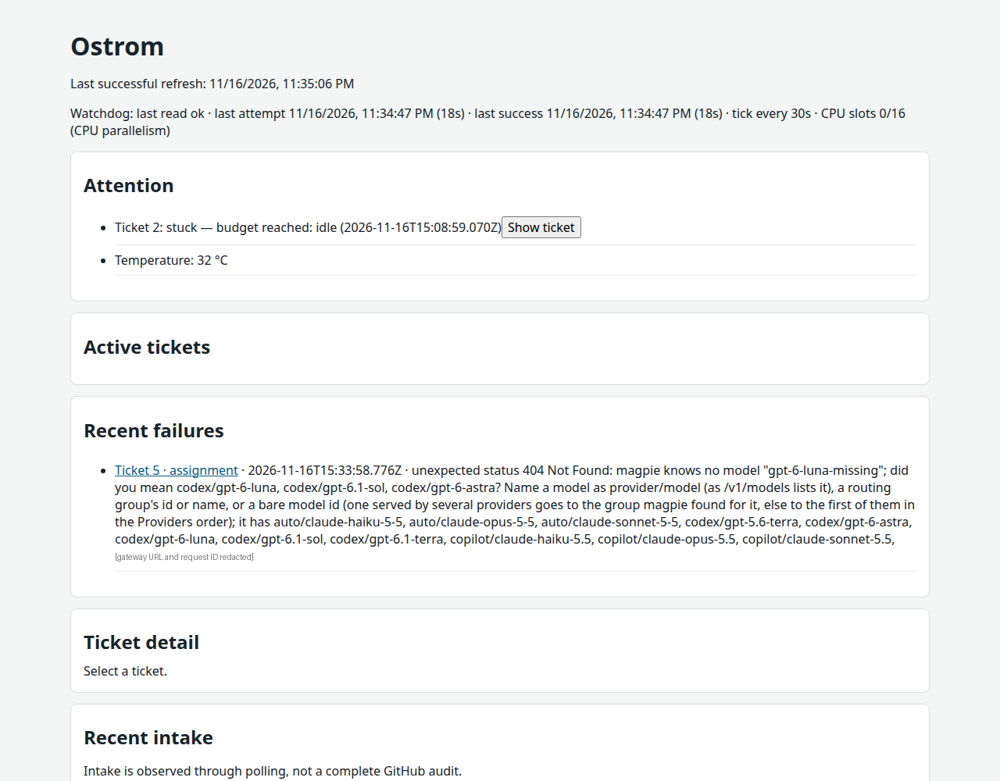
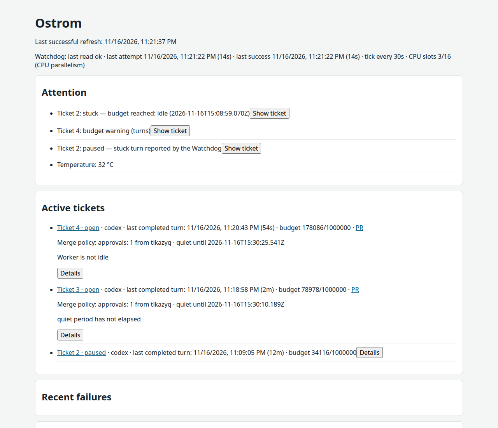
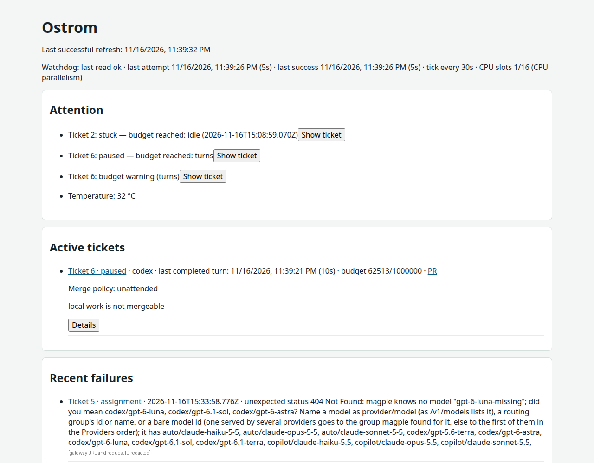
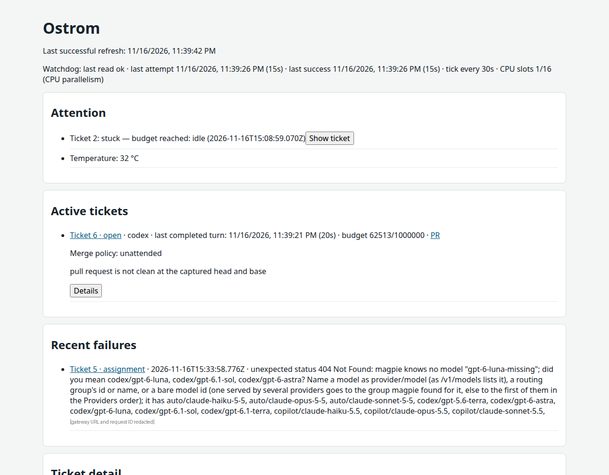
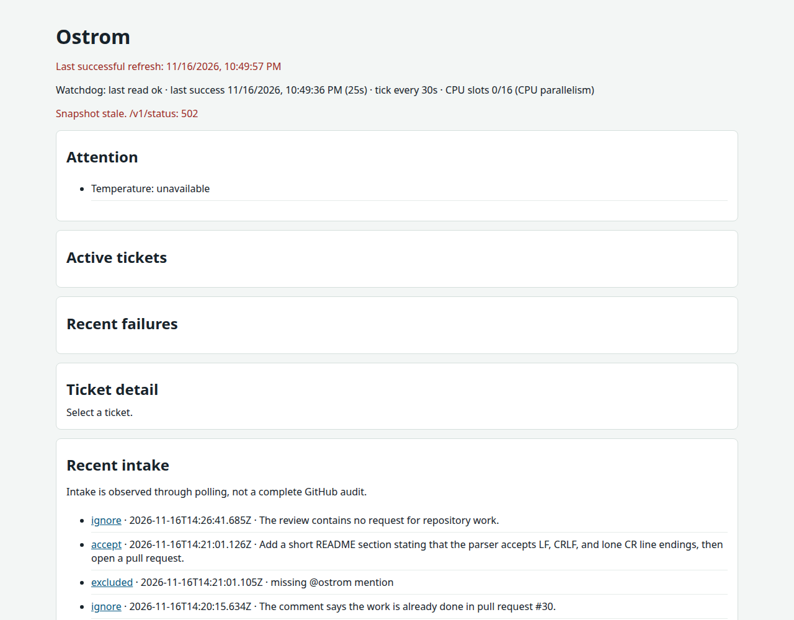

# Milestone 3 dashboard run on hp-code-2

Status: passed, 2026-11-16, after three fixes found by the run itself. This run checks
[the dashboard design](dashboard.md)'s live acceptance against the public sandbox
`onsager-ai/ostrom-sandbox`. All times are UTC. Screenshots are in [e2e-m3/](e2e-m3/).

## Setup

- Host hp-code-2 (30–43 °C). The daemon ran as `thermal gate --max-seconds 5400 -- node
  src/ostromd/main.ts run --interval 30` from the primary checkout; `ostrom dashboard` ran beside it.
- Identity: GitHub App `ostrom-agent` (bot user ID 315274524), as in [the M2 run](e2e-m2-hp2.md).
- Router and Worker: Codex `gpt-6-luna`. Batch window 2 minutes, comment gap 5 minutes.
- Store: `~/.local/state/ostrom-e2e/ostrom-m3-hp2.sqlite`, fresh at 14:20.
- Revisions: `1d3dd82` (runs 1–2), `9c63be0` (run 3, after #721 and #722), `5d2e867` (run 4,
  after #723). Per-run settings were set with a sourced overrides file; none was secret.
- Screenshots: headless Chrome through the DevTools protocol, so the script could click
  "Details". The bridge token never appears on the page; it is removed from the URL on load.

| Run | Policy | Overrides | Purpose |
|---|---|---|---|
| 1 | approvals | a `semon` on PATH that exits 1 | intake, ticket view, Watchdog failure |
| 2 | approvals | none | Watchdog recovery after restart, approvals wait, CLI pause/resume |
| 3 | approvals | `OSTROM_BUDGET_TURNS=5`, `OSTROM_STALL_MINUTES=2` | approval merge, stall, budget warning |
| 4a | unattended | `OSTROM_WORKER_MODEL=gpt-6-luna-missing` | controlled dispatch failure |
| 4b | unattended | `OSTROM_BUDGET_TURNS=2` | budget pause and CLI extension |

## Results

| Step | Result | Evidence |
|---|---|---|
| 1. Intake and ticket view | Pass | Unmentioned [#31](https://github.com/onsager-ai/ostrom-sandbox/issues/31) shown `excluded · missing @ostrom mention` within one poll; [#32](https://github.com/onsager-ai/ostrom-sandbox/issues/32) became ticket 1 with issue and PR links, session ID and last completed turn |
| 2. Approvals wait and merge | Pass | [PR #37](https://github.com/onsager-ai/ostrom-sandbox/pull/37) showed `policy approvals are not satisfied` with the review reminder, then `quiet period has not elapsed`; merged by the App at 15:31:16 |
| 3. Failure after the ticket ends; CLI pause/resume | Pass after fixes | Ticket 5's 404 stays under Recent failures after the ticket ended; `ostrom pause 1` / `resume 1` were followed on the same session |
| 4. Budget warning, pause, extension; stall item | Pass after fixes | Ticket 4 showed `budget warning (turns)`; ticket 6 paused with `budget reached: turns`, resumed after `ostrom extend 6` and merged unattended; ticket 2 showed `stuck — budget reached: idle` |
| 5. Watchdog failure, recovery, restart, stale snapshot | Pass | Failure text shown; after restart health was all null, then `last read ok`; a stopped daemon turned the page stale and it recovered |
| 6. Bridge security | Pass | See below |

### 1. Intake and ticket view

Run 1, revision `1d3dd82`. Issue #31 (no mention) and #32 (mention) opened at 14:20:30. The
14:21:01 poll stored #31's exclusion receipt; the Router accepted #32 as ticket 1, assignment 1,
session `01a1e4bb-ad49-7742-946c-87313c348f8b`. The App opened
[PR #33](https://github.com/onsager-ai/ostrom-sandbox/pull/33) at 14:22:59. Two earlier comments
of mine on closed issues #27 and #29 showed as `ignore` with the Router's reason.

### 2. Approvals wait and merge

In run 1 the merge reason read `an earlier prerequisite pass failed`: the failing Watchdog held the
merge, as designed. In run 2 it became `policy approvals are not satisfied` with the
submitted-review reminder ([screenshot](e2e-m3/05-recovered.png)).

That first approval did not complete (see failure 2 below), so run 3 repeated it. Issue
[#34](https://github.com/onsager-ai/ostrom-sandbox/issues/34) became ticket 3, session
`01a1e4de-5530-75c0-9d1a-1617bba7f459`, PR #37 (head `a596d6dd`, `ci` / `test` passed). The
operator approved with an empty body at 15:16:48; the page then showed `quiet period has not
elapsed` with the deadline. The `pr_merge` row: `merge_sha=aeaeb17a…`,
`merged_by_login=ostrom-agent[bot]`, `merged_by_id=315274524`, `origin=ostrom`, `attempt_id=1`.
Ticket 3 ended at 15:31:23.

### 3. Failure kept after the ticket ends; CLI pause and resume

Run 2: `ostrom pause 1` at 14:25:36 and `ostrom resume 1` at 14:25:45. The page followed the same
session ID through both ([screenshot](e2e-m3/06-paused.png)); the pause showed `cause unavailable`
until #721.

Run 4a: issue [#39](https://github.com/onsager-ai/ostrom-sandbox/issues/39) became ticket 5,
session `01a1e4fe-3863-70d1-ba2c-4a857e7a99c8`. Its first turn failed at 15:33:58 with the
gateway's 404 for the unknown model. The ticket ended at 15:34:57; the full reason stayed under
Recent failures, and the issue's status card reads `Ostrom: Failed`.

### 4. Budget warning, pause and extension; stall

Run 3 seeded a scripted stall ([watchdog.md](watchdog.md)) on issue
[#36](https://github.com/onsager-ai/ostrom-sandbox/issues/36) as ticket 2, with a 3-minute idle
budget. The idle budget flagged it at 15:01:52 and 15:05:34 (recoveries 1 and 2) and published it
at 15:08:59; the page showed `Ticket 2: stuck — budget reached: idle`.

Issue [#35](https://github.com/onsager-ai/ostrom-sandbox/issues/35) became ticket 4, session
`01a1e4de-560f-7c80-b18d-f6bdc652b8b1`, [PR #38](https://github.com/onsager-ai/ostrom-sandbox/pull/38).
Three review comments took it to turn 4 of 5, and the page showed `budget warning (turns)`. The
fifth turn exposed failure 3 below ([screenshot](e2e-m3/11-turn-budget-ladder-bug.png)).

Run 4b, revision `5d2e867`, `OSTROM_BUDGET_TURNS=2`: issue
[#40](https://github.com/onsager-ai/ostrom-sandbox/issues/40) became ticket 6, session
`01a1e500-0778-75c3-a0fe-cae880b32cd2`, [PR #41](https://github.com/onsager-ai/ostrom-sandbox/pull/41).
One review comment started turn 2. That turn finished, and at 15:39:16 the ticket paused with
`budget reached: turns`, then ran the allowed push-your-work turn. `ostrom extend 6 --time 30
--turns 3` at 15:39:36 reopened it (turns 3/5), and the next refresh showed it open with no pause
item. PR #41 then merged unattended at 15:53:35 (`merge_sha=f3559c92…`, `merged_by_id=315274524`,
`origin=ostrom`, `attempt_id=2`), and ticket 6 ended: the first live resume-to-merge after a
pause, which the milestone-2 runs left to unit tests.

### 5. Watchdog health

Run 1 put a `semon` that exits 1 first on PATH. Every tick reported the Watchdog failure, and the
page showed the error ([screenshot](e2e-m3/01-start.png)). Run 2 restarted with the real Semon at
14:24:37; the first successful read was at 14:24:49 and the page showed `last read ok`. At the
run-3 start (14:58:07) `/v1/status` returned
`{"lastAttemptAt":null,"lastSuccess":null,"lastSuccessAt":null,"error":null}` before the first
read: health resets to unknown on restart. Stopping the daemon at 14:49:57 with the page open
marked it `Snapshot stale. /v1/status: 502` while it kept the last data; it recovered after the
restart.

### 6. Bridge security

Checked against the run-1 bridge (port 34977):

| Check | Result |
|---|---|
| Listening sockets | `127.0.0.1:34977` only; a connection to the LAN address was refused |
| `/v1/status` without a token or with a wrong token | 401 |
| `/v1/status` with the token | 200 |
| Token in the query string instead of the header | 404 |
| `POST /v1/tickets/1/pause`, `POST …/extend` | 404 |
| `GET /v1/preview`; `/v1/intake?limit=200` | 404 (not on the allowlist) |
| Foreign `Host` or `Origin` header | 403 |
| After the CLI exited | nothing listens on 34977; connection refused |

The page has no mutating controls; it shows the CLI commands instead.

## Failures found by the run, and their fixes

| Failure | Fix |
|---|---|
| The page showed `Temperature: unavailable` on a host with a sensor: the API read a log file only hp-code-1 writes. An operator pause showed `cause unavailable`. The merge policy was raw JSON, the last Watchdog attempt was missing, and outbox rows said only `pending` | [#721](https://github.com/onsager-ai/ostrom/pull/721) |
| Ticket 1 ended as failed at 14:30:41 on Codex's `Reconnecting... 1/5` notice, which Ostrom treated as fatal; Codex finished the turn at 14:31:07. A queued turn then ran on the failed assignment and cleared the error, so the page showed no reason. GitHub got `Ostrom: Done` and "No pull request was opened" although PR #33 was open and approved | [#722](https://github.com/onsager-ai/ostrom/pull/722): Codex `error` events are notices; failed assignments start no turns; a late result can't clear a failure; the outcome reply gets the PR, and the card says Failed |
| Turns count when a turn starts, so the Watchdog flagged `budget reached: turns` as ticket 4's last allowed turn began (15:24:05), cancelled it and ran recovery turns past the limit | [#723](https://github.com/onsager-ai/ostrom/pull/723): the Watchdog enforces only time and idle; turn and token limits pause after the turn, including a cancelled one |

## Follow-ups

- [#725](https://github.com/onsager-ai/ostrom/issues/725): an approval with an empty body still queued a Worker turn for ticket 3 (15:18:30). The M2 notes
  said it did not; they were wrong.
- [#726](https://github.com/onsager-ai/ostrom/issues/726): an ended ticket's published stall stays in Attention (ticket 2 after 15:33).
- [#727](https://github.com/onsager-ai/ostrom/issues/727): a ticket row shows the token count even when the warning is for turns.
- [#715](https://github.com/onsager-ai/ostrom/issues/715): provider at start versus resume, not
  exercised here.
- Sandbox PR #33 is a correct change stranded by the second failure; it is closed with a note.
